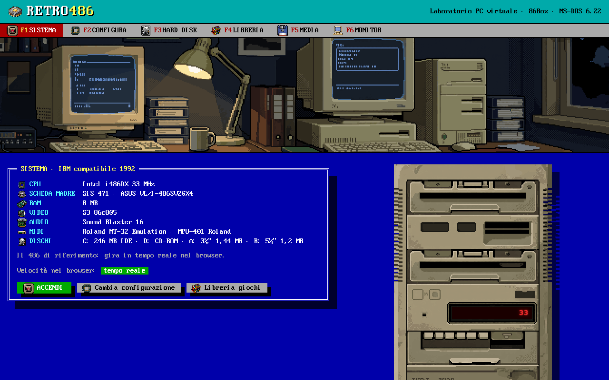
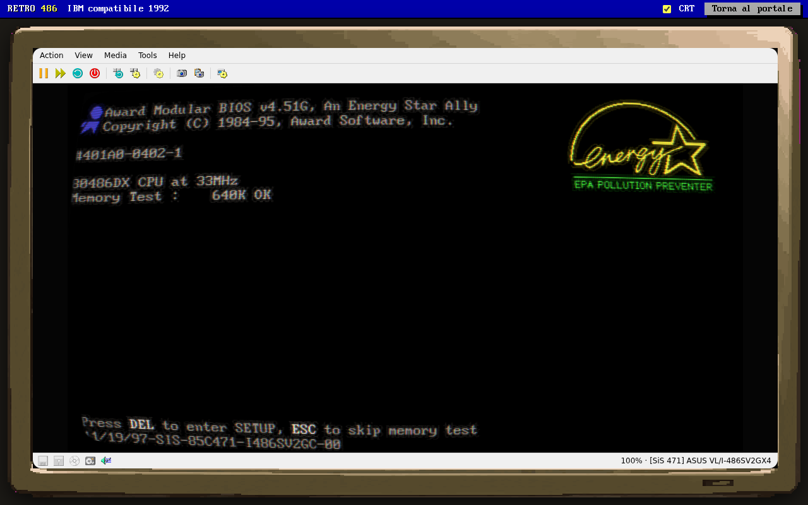
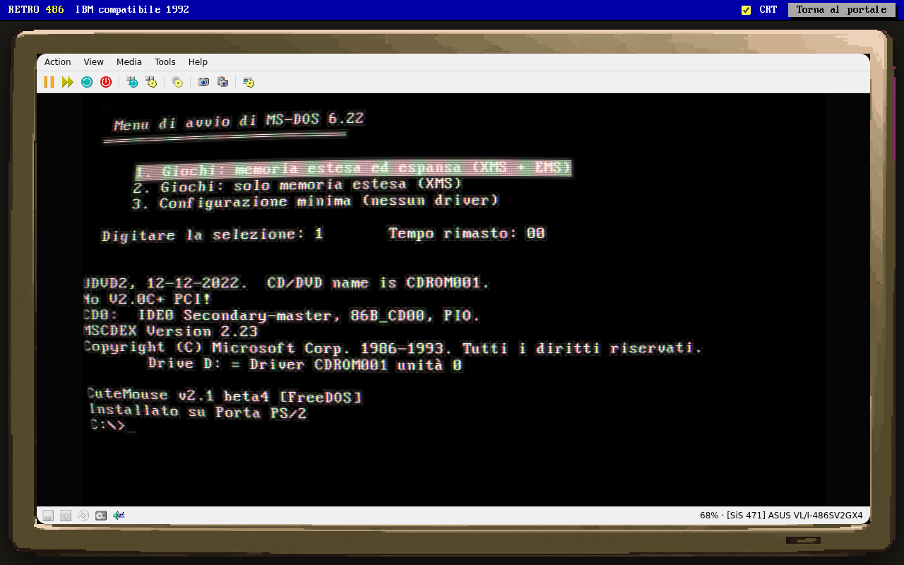
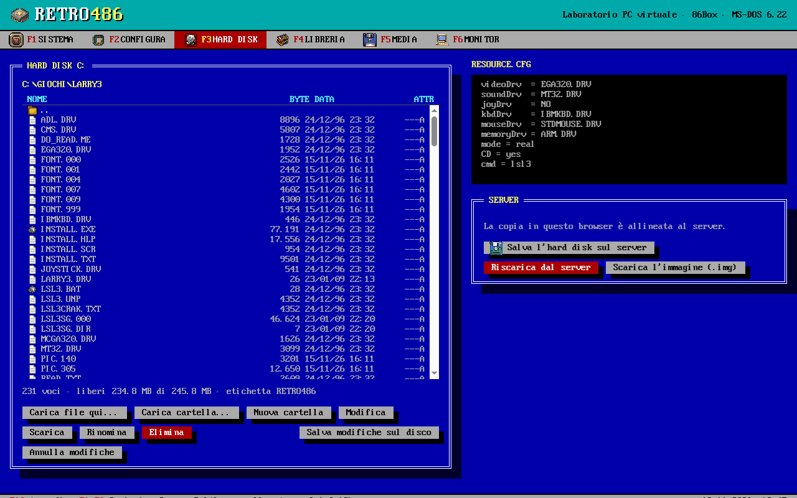
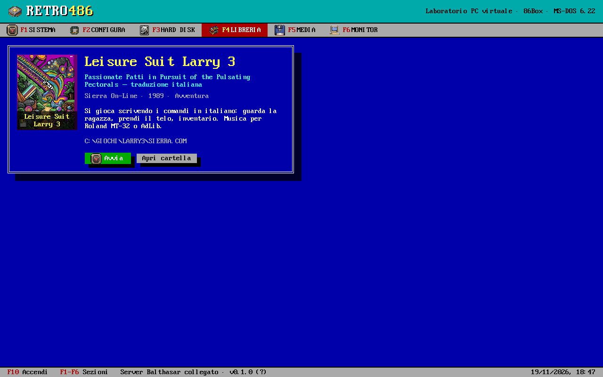
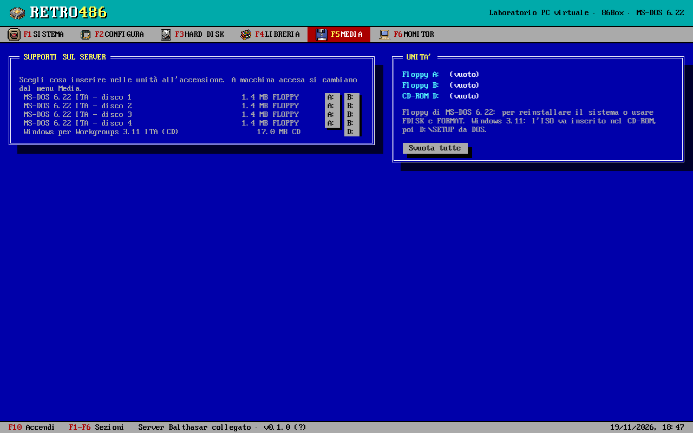

# Retro486

**Un PC 486 vero, nel browser.** Retro486 è un laboratorio di PC virtuale: **86Box** compilato in
WebAssembly emula la macchina componente per componente (BIOS e chipset reali, CPU al loro clock, schede
S3, Sound Blaster 16, Roland MT-32), con **MS-DOS 6.22 italiano** già installato su un hard disk preparato
da zero, un **portale in stile BIOS/DOS** per configurare l'hardware, esplorare il disco, lanciare i giochi e
regolare un **monitor CRT emulato**, e un piccolo backend PHP su Balthasar, il server di casa, che conserva
dischi, profili e supporti.



> Indirizzo: https://example.org/retro486/ (privato, con password).

## Indice

- [In breve](#in-breve)
- [Immagini](#immagini)
- [Il portale, sezione per sezione](#il-portale-sezione-per-sezione)
- [La macchina emulata](#la-macchina-emulata)
- [L'hard disk C:](#lhard-disk-c)
- [Il monitor CRT](#il-monitor-crt)
- [Velocità, onestamente](#velocità-onestamente)
- [Architettura](#architettura)
- [Struttura del repository](#struttura-del-repository)
- [Preparazione da zero](#preparazione-da-zero)
- [Pubblicazione su Balthasar](#pubblicazione-su-balthasar)
- [Grafica](#grafica)
- [Licenze e materiale protetto](#licenze-e-materiale-protetto)

## In breve

| | |
|---|---|
| **Emulatore** | 86Box 7.0 (core originale, interprete) in WebAssembly a 64 bit con thread, dal port [Web86Box](https://github.com/Xeon3D/Web86Box) |
| **Macchina di riferimento** | ASUS VL/I-486SV2GX4 (SiS 471, VLB, Award BIOS 4.51G) · Intel i486DX-33 · 8 MB · S3 86c805 VLB · Sound Blaster 16 · Roland MT-32 su MPU-401 |
| **Configurabile** | 64 CPU reali per questa scheda (Intel, AMD, Cyrix: dal 486SX-20 al 5x86-160 e al Pentium OverDrive), ogni scheda madre 486 di 86Box con BIOS disponibile, RAM, video, audio, MIDI, mouse, floppy, CD-ROM, e il dialogo completo delle impostazioni di 86Box |
| **Sistema** | MS-DOS 6.22 italiano, menu di avvio XMS+EMS / XMS / minimo, CD-ROM su D:, mouse, tastiera italiana, `BLASTER` impostato |
| **Giochi** | Libreria con avvio diretto; per ora Leisure Suit Larry 3 nella traduzione italiana di [melchior-larry3](https://github.com/Indr1d-C0ld/leisure-suit-larry-3-ita) |
| **Monitor** | CRT in WebGL2 (curvatura, scanline, maschera dei fosfori, bloom, persistenza...) con ripiego su Canvas 2D senza GPU |
| **Server** | Apache + PHP 8.4 su Balthasar: hard disk compresso (6,5 MB), profili, CMOS, floppy e CD; Basic Auth |
| **Browser** | Chrome, Edge, Firefox recenti (serve memory64: Safari no) |

## Immagini

| | |
|---|---|
|  |  |
| Accensione: il BIOS video S3 e il POST Award, dentro il monitor | Il menu di avvio di MS-DOS 6.22: UDVD2, MSCDEX, CuteMouse |
|  |  |
| Leisure Suit Larry 3 in italiano, con la musica sulla MT-32 emulata | La sezione MONITOR: preset e 26 regolazioni del CRT |
|  |  |
| CONFIGURA: scheda madre, CPU, RAM, video, audio, MIDI | HARD DISK: l'esplora-disco sul FAT16 del C: |
|  |  |
| LIBRERIA: avvio diretto dei giochi | MEDIA: i floppy di MS-DOS e il CD di Windows 3.11 |

## Il portale, sezione per sezione

Interfaccia in modo testo VGA: palette a 16 colori, font 8x16 ricavato da un BIOS VGA, riquadri a doppia
linea con l'ombra, tasti funzione come in un programma DOS.

| Tasto | Sezione | Cosa fa |
|---|---|---|
| **F1** | SISTEMA | Scheda tecnica della macchina, case con i MHz sul display a 7 segmenti, stato delle unità, accensione (**F10**) |
| **F2** | CONFIGURA | Profili hardware predefiniti e personali (salvati sul server). Ogni scelta è filtrata sul catalogo di 86Box: solo CPU, schede e periferiche compatibili con la scheda madre. *Impostazioni avanzate 86Box* apre il dialogo completo (wait state, controller, porte, rete, configurazione di ogni dispositivo). Indica quanto è pesante la CPU scelta per il browser |
| **F3** | HARD DISK | Esplora-disco del C: a macchina spenta: navigazione, anteprima testo/esadecimale, editor per AUTOEXEC.BAT e CONFIG.SYS (code page 437, lettere accentate comprese), caricamento di file e cartelle dal PC (nomi lunghi convertiti in 8.3), rinomina, eliminazione, nuova cartella. Riscrive solo i blocchi da 64 KB cambiati. Salvataggio dell'hard disk sul server, ripristino, download dell'immagine |
| **F4** | LIBRERIA | Giochi installati con *Avvia*: il portale scrive `C:\RETRO486\AVVIO.BAT`, che AUTOEXEC.BAT esegue, e sceglie il driver audio del gioco in base al profilo (MT-32 o AdLib) |
| **F5** | MEDIA | Floppy e CD da inserire all'accensione; a macchina accesa si cambiano dal menu Media |
| **F6** | MONITOR | Il CRT emulato: preset, regolazioni, anteprima |

La macchina accesa usa la finestra di Web86Box (menu Action/View/Media/Tools, barra di stato con l'attività
dei dischi) dentro la cornice del monitor pixel art. *Torna al portale* spegne il PC.

## La macchina emulata

86Box non simula "un PC DOS": simula **quel** PC. La CPU gira al suo clock (un DX-33 fa ciò che faceva un
DX-33), il BIOS è quello vero della scheda madre con il suo SETUP, le schede video e audio sono i chip
originali. Retro486 aggiunge:

- **CMOS già impostata** per la ASUS VL/I-486SV2GX4 (`app/profili/nvr/vli486sv2g.nvr`): parametri
  "User" del disco (500/16/63) scritti nella NVRAM Award con il loro checksum. La prima accensione va
  dritta a MS-DOS. Con altre schede madri si entra nel SETUP (CANC), come su un PC vero.
- **MIDI come nel 1990**: Roland MPU-401 in modalità intelligente a 330h (quella che vogliono i driver
  Sierra), con l'MPU UART della SB16 spento per non sovrapporsi. MT-32 (ROM 1.07), MT-32 nuova (2.04) e
  CM-32L, emulate da Munt dentro 86Box.
- **Controller IDE VLB** a due canali: disco sul primario, CD-ROM ATAPI sul secondario.

Profili predefiniti:

| Profilo | Macchina | Nel browser |
|---|---|---|
| IBM compatibile 1992 | i486DX-33, 8 MB, S3 805, SB16, MT-32 | tempo reale |
| Gaming Rig 1994 | i486DX2-66, 16 MB, S3 Trio64, SB16, MT-32 | esigente |
| Top di gamma 1995 | iDX4-100, 32 MB, S3 Trio64, SB16, MT-32 | molto esigente |
| PC economico 1991 | i486SX-25, 4 MB, ET4000, SB Pro 2 | tempo reale |
| Postazione Windows 3.11 | i486DX2-66, 16 MB, S3 Trio64, SB16 | esigente |

## L'hard disk C:

`tools/crea-disco.mjs` fa quello che farebbero FDISK, FORMAT C: /S e SETUP, **senza emulatore**, in modo
riproducibile:

1. **MBR** scritto qui (`tools/mbr/mbr.S`, 227 byte, messaggi in italiano): il codice MBR di MS-DOS è
   compresso dentro FDISK.EXE.
2. **Partizione FAT16** attiva da 246 MB, geometria 500 cilindri × 16 testine × 63 settori.
3. **Settore di avvio di MS-DOS** preso dal disco 1, con il BPB del disco fisso.
4. **IO.SYS e MSDOS.SYS** come prime voci della directory e contigui, come vuole il loader.
5. **Tutti i file dei quattro dischi** espansi in `C:\DOS`: MS-DOS 6 li comprime nel formato KWAJ
   (LZ + Huffman), decompresso da `app/js/expand.js`; i nomi originali vengono da PACKING.LST.
6. `CONFIG.SYS` con menu di avvio (HIMEM, EMM386, UDVD2) e `AUTOEXEC.BAT` (SMARTDRV, MSCDEX, CuteMouse,
   `KEYB IT`, `BLASTER=A220 I5 D1 H5 P330 T6`, avvio dei giochi).
7. **Driver liberi** in `C:\DRIVERS`: CuteMouse e UDVD2 da FreeDOS (`tools/disco/driver`).
8. **Giochi** di `tools/libreria.json` in `C:\GIOCHI`.

Il risultato pesa 247 MB e, compresso, 6,5 MB: il browser lo scarica alla prima accensione e lo tiene
nell'Origin Private File System. `app/js/fat.js` (FAT12/16, lettura e scrittura) è lo stesso modulo in Node
e nel browser.

## Il monitor CRT


Lo shader WebGL2 (`app/js/retro/crt.js`) prende ogni fotogramma di 86Box e lo ridisegna con: curvatura,
angoli arrotondati, allungamento e posizione dell'immagine, overscan, scanline gaussiane con larghezza che
dipende dalla luminosità, maschera dei fosfori (griglia di apertura, punti, fessure), bloom, persistenza dei
fosfori, fosfori monocromatici (verde, ambra, bianco), luminosità, contrasto, saturazione, nitidezza, gamma,
vignettatura, convergenza RGB, rumore, sfarfallio, instabilità orizzontale e riflesso del vetro.

Preset: *VGA 14" 1992*, *Trinitron 15"*, *SVGA 17"*, *Monitor economico usurato*, *Monocromatico fosfori
verdi*, *Monocromatico ambra*, *Spento*. Dove manca WebGL (per esempio nel pannello browser dell'app Claude,
che non ha GPU) entra in gioco un secondo motore su Canvas 2D con le stesse regolazioni e la curvatura
approssimata a fasce.

## Velocità, onestamente

I ricompilatori dinamici di 86Box generano codice x86, che WebAssembly non può eseguire: nel browser lavora
l'interprete. Misure su Melchior, al prompt di MS-DOS:

| CPU emulata | Velocità rispetto al reale |
|---|---|
| i486DX-33 | 93-100% |
| i486DX2-66 | 51-53% |

Il clock resta fedele finché l'host ce la fa; oltre, la macchina rallenta in modo uniforme (non accelera
mai). La build con `-flto -msimd128` guadagna circa il 4%. Per DX2-66 e DX4-100 a piena velocità servirebbe un
ricompilatore verso WebAssembly (PCem-WebAssembly ne ha uno per PCem: è il prossimo passo possibile).

## Architettura

```
 browser                                                         Balthasar (Apache + PHP)
┌───────────────────────────────────────────────┐               ┌──────────────────────────┐
│ portale Retro486 (app/js/retro)               │  api/*.php    │ api/stato.php            │
│  SISTEMA CONFIGURA HARD DISK LIBRERIA ...     │ ◀───────────▶ │ api/disco.php (PUT gzip) │
│  profili → 86box.cfg   fat.js su C:           │               │ api/profili.php nvr.php  │
│                                               │  dati/...     │ api/media.php            │
│ Web86Box: finestra, input, audio              │ ◀──────────── │ dati/dischi/c.img.gz     │
│  canvas ──▶ CRT WebGL2 / Canvas 2D            │               │ dati/media, nvr, json    │
├───────────────────────────────────────────────┤  roms/...     │ roms/ (BIOS, MT-32)      │
│ 86Box.wasm (memory64, thread)                 │ ◀──────────── │ 86Box.wasm, portale      │
│  CPU, chipset, S3, SB16, MPU-401, Munt        │               └──────────────────────────┘
│  /opfs: vms/retro486/{86box.cfg, c.img, nvr}  │                 Basic Auth, COOP/COEP
└───────────────────────────────────────────────┘
```

L'emulazione gira tutta nel browser: il server consegna file e conserva le copie di riferimento. La copia
di lavoro (disco, CMOS, configurazione) sta nello storage del browser; *Salva l'hard disk sul server* la
comprime e la invia (il server tiene le tre versioni precedenti).

## Struttura del repository

```
app/                   portale (sito statico)
  index.html
  js/retro/            portale.js, profili.js, crt.js, disco.js, server.js
  js/fat.js            FAT12/16 su immagini disco (browser e Node)
  js/expand.js         decompressione SZDD/KWAJ dei dischi Microsoft
  js/*.js              frontend di Web86Box (GPL-2.0), con piccole modifiche
  css/                 86box.css (Web86Box) e retro486.css (tema BIOS/DOS)
  fonts/vga8x16.woff   font VGA 8x16 dal VGABIOS LGPL (tools/font/crea-font.py)
  assets/pixel/        grafica PixelLab + manifest.json
  profili/nvr/         CMOS predefinite per scheda madre
api/                   backend PHP
tools/
  crea-disco.mjs       hard disk C: con MS-DOS 6.22, driver e giochi
  libreria.json        i giochi da installare
  prepara-dati.sh      data/: disco compresso, libreria, supporti
  costruisci.sh        dist/: 86Box + ROM + portale + api
  mbr/  disco/driver/  font/  pixellab/  86box/  dev/
deploy/                pubblica.sh, pubblica-dati.sh, balthasar/ (Apache + installatore)
docs/img/              immagini del README (tools/dev/screenshot.mjs)
vendor/  (ignorata)    Web86Box con 86Box come sottomodulo, set di ROM di 86Box
media/   (ignorata)    immagini di MS-DOS 6.22 e Windows 3.11
data/    (ignorata)    hard disk e supporti preparati; sul server diventa dati/
```

## Preparazione da zero

Toolchain in spazio utente: Emscripten SDK 6.0.12 in `~/.local/opt/emsdk`, cmake e ninja ufficiali in
`~/.local/opt` e `~/.local/bin`.

```bash
mkdir -p vendor && cd vendor
git clone --recursive https://github.com/Xeon3D/Web86Box.git
git init -q roms && git -C roms remote add origin https://github.com/86Box/roms.git
git -C roms fetch -q --depth 1 origin c69660478eeab51a1ad32e586841bca878f292d0 && git -C roms checkout -q FETCH_HEAD
cd ..
source ~/.local/opt/emsdk/emsdk_env.sh
CMAKE_POLICY_VERSION_MINIMUM=3.5 ROMS_DIR=$PWD/vendor/roms bash tools/86box/build-ottimizzata.sh
```

Hard disk, dati e sito (le immagini di MS-DOS 6.22 in `media/os/msdos-6.22-ita/Disk01..04.img`, le ROM
MT-32 in `~/.local/share/melchior688/mt32/rom/mt32pi`):

```bash
node tools/crea-disco.mjs
bash tools/prepara-dati.sh
bash tools/costruisci.sh
```

In locale (configurazione `retro486` di `.claude/launch.json`):

```bash
ln -sfn ../data dist/dati
php -S 127.0.0.1:8486 -t dist tools/dev/router.php
```

Screenshot del README: `node tools/dev/screenshot.mjs` (Chromium headless con WebGL software).

## Pubblicazione su Balthasar

Prima volta (il passo con sudo chiede password, quindi lo lanci tu):

```bash
bash deploy/pubblica.sh --installatore
ssh -t balthasar sudo bash ~/Claude/balthasar-retro486/installa.sh
bash deploy/pubblica-dati.sh
bash deploy/pubblica.sh
```

Poi, a ogni modifica: `bash deploy/pubblica.sh`. La cartella `dati/` sul server non viene mai toccata dalla
pubblicazione del sito; `pubblica-dati.sh` non sovrascrive l'hard disk del server se non con `--forza`.
Utenti: `sudo htpasswd /etc/apache2/.htpasswd-retro486 <utente>` su Balthasar.

## Grafica


Icone, case, monitor, banner, logo, modulo MT-32 e copertina predefinita sono di PixelLab
(`create_image_pixen`), in `app/assets/pixel/` con `manifest.json`. Le descrizioni sono in
`tools/pixellab/set.json`; `genera.py` le genera (8 lavori alla volta), `rifinisci.py` toglie gli sfondi,
apre lo schermo del monitor e misura le zone utili (l'apertura del monitor per la cornice 9-slice, il
display dei MHz del case). Il connettore PixelLab dell'app parte senza token: `tools/pixellab/pixellab.py`
legge quello della voce `pixellab` di `~/.claude.json` senza stamparlo né copiarlo.

## Licenze e materiale protetto

Il codice è **GPL-2.0 o successiva**, come 86Box e Web86Box (`LICENSE`). Il font è ricavato dal VGABIOS
LGPL; CuteMouse e UDVD2 vengono da FreeDOS (GPL / liberi con sorgenti).

**Non sono nel repository**: MS-DOS 6.22 e Windows 3.11, i giochi, le ROM dei BIOS (set di 86Box) e quelle
della Roland MT-32. Il sito è protetto da password proprio perché li serve.
