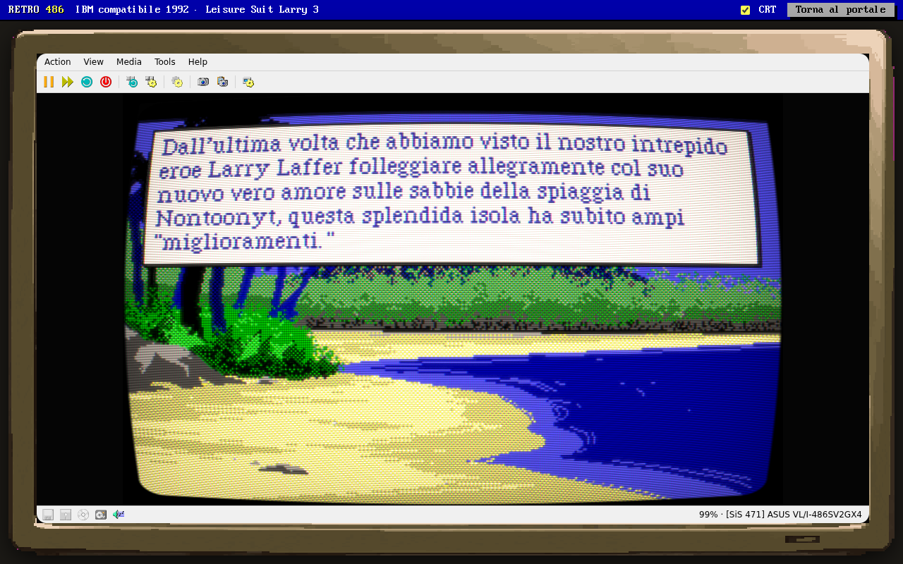
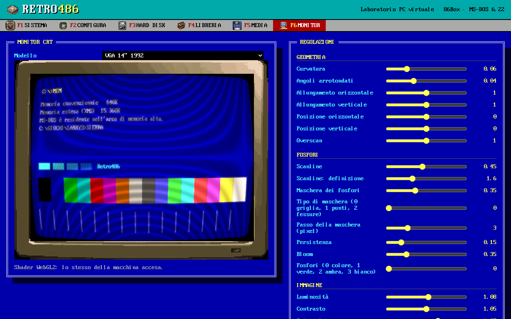
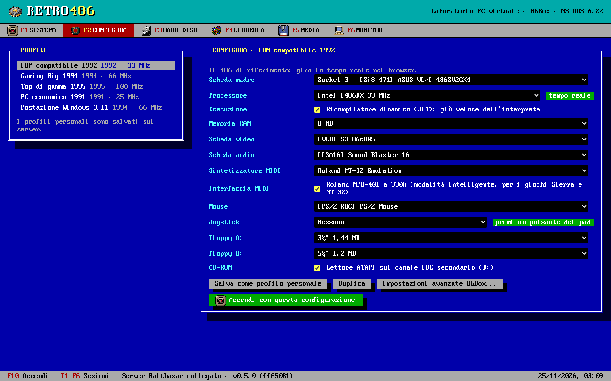
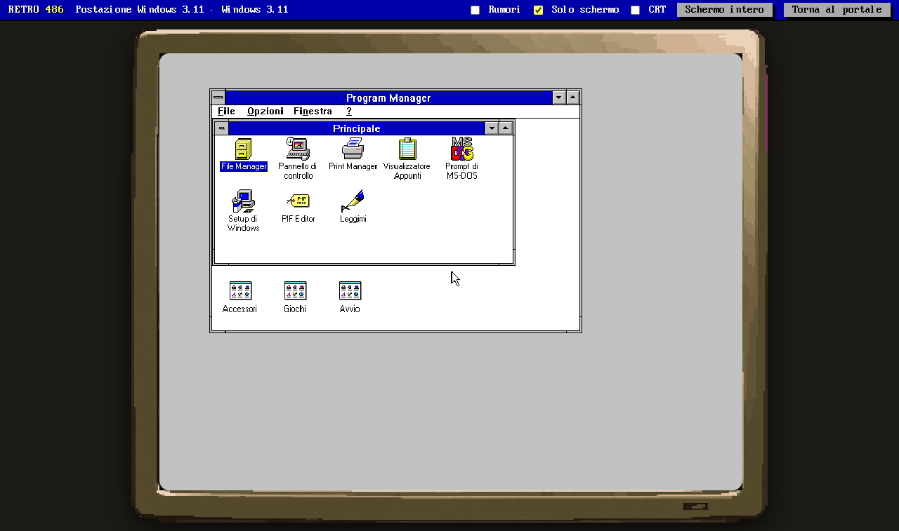
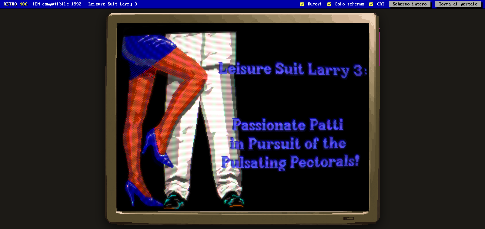
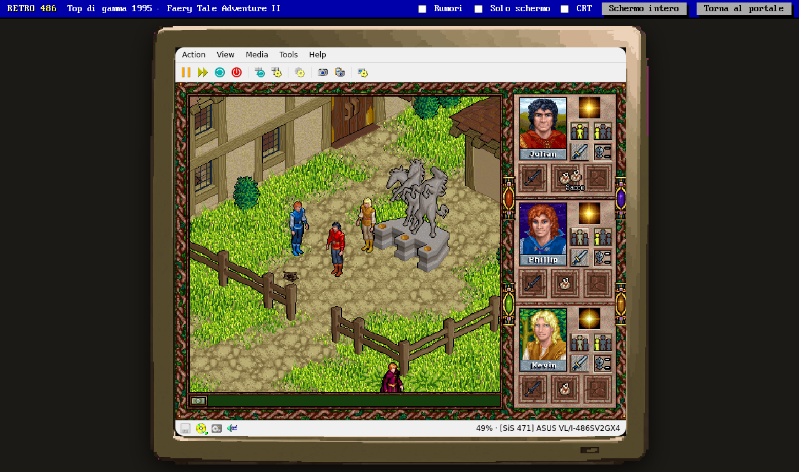
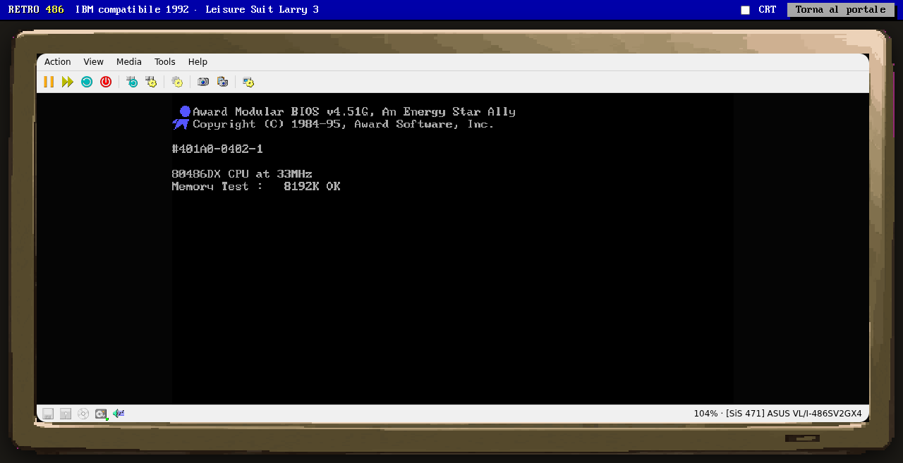
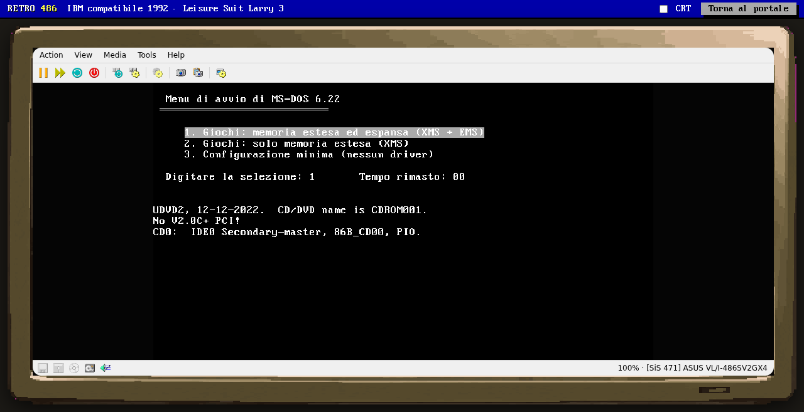
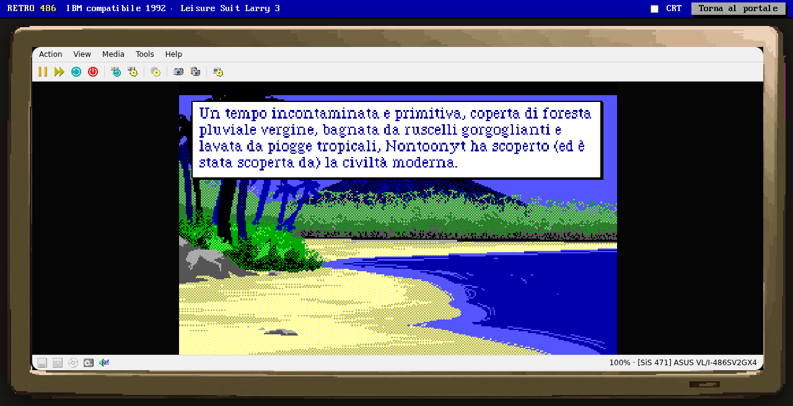
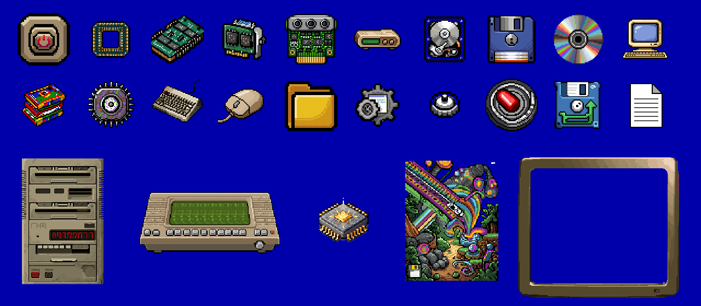

# Retro486

**Un PC 486 vero, nel browser.** Retro486 è un laboratorio di PC virtuale: **86Box** compilato in
WebAssembly emula la macchina componente per componente (BIOS e chipset reali, CPU al loro clock, schede
S3, Sound Blaster 16, Roland MT-32), con **MS-DOS 6.22 italiano** già installato su un hard disk preparato
da zero, un **portale in stile BIOS/DOS** per configurare l'hardware, esplorare il disco, lanciare i giochi e
regolare un **monitor CRT emulato**, e un piccolo backend PHP su Balthasar, il server di casa, che conserva
dischi, profili e supporti.


> Il sito pubblicato è aperto a tutti; scrive sul server solo l'admin. L'indirizzo non è nel repository:
> `deploy/pubblica.sh` lo legge da `deploy/locale.env` (vedi `deploy/locale.env.esempio`).

## Indice

- [In breve](#in-breve)
- [Immagini](#immagini)
- [Il portale, sezione per sezione](#il-portale-sezione-per-sezione)
- [La macchina emulata](#la-macchina-emulata)
- [Joystick e pad](#joystick-e-pad)
- [Aggiungere giochi dal portale](#aggiungere-giochi-dal-portale)
- [General MIDI](#general-midi)
- [Windows 3.11](#windows-311)
- [Chi può fare cosa](#chi-può-fare-cosa)
- [Durante il gioco](#durante-il-gioco)
- [L'hard disk C:](#lhard-disk-c)
- [Il monitor CRT](#il-monitor-crt)
- [Velocità, onestamente](#velocità-onestamente)
- [Architettura](#architettura)
- [Struttura del repository](#struttura-del-repository)
- [Preparazione da zero](#preparazione-da-zero)
- [Pubblicazione su Balthasar](#pubblicazione-su-balthasar)
- [Grafica](#grafica)
- [Licenze e materiale protetto](#licenze-e-materiale-protetto)

## In breve

| | |
|---|---|
| **Emulatore** | 86Box 7.0 (core originale) in WebAssembly a 32 bit con thread, dal port [Web86Box](https://github.com/Xeon3D/Web86Box), con il ricompilatore dinamico di 86Box portato a WebAssembly (interprete sempre disponibile) |
| **Macchina di riferimento** | ASUS VL/I-486SV2GX4 (SiS 471, VLB, Award BIOS 4.51G) · Intel i486DX-33 · 8 MB · S3 86c805 VLB · Sound Blaster 16 · Roland MT-32 su MPU-401 (in alternativa General MIDI Yamaha OPL4-ML) |
| **Configurabile** | 64 CPU reali per questa scheda (Intel, AMD, Cyrix: dal 486SX-20 al 5x86-160 e al Pentium OverDrive), ogni scheda madre 486 di 86Box con BIOS disponibile, RAM, video, audio, MIDI, joystick e pad, mouse, floppy, CD-ROM, e il dialogo completo delle impostazioni di 86Box |
| **Sistema** | MS-DOS 6.22 italiano, menu di avvio XMS+EMS / XMS / minimo, CD-ROM su D:, mouse, tastiera italiana, `BLASTER` impostato. Facoltativo: Windows 3.11 già pronto, installabile dalla libreria |
| **Giochi** | Libreria con avvio diretto, giochi aggiunti dal portale da un archivio ZIP; di serie Leisure Suit Larry 3 nella traduzione italiana di [melchior-larry3](https://github.com/Indr1d-C0ld/leisure-suit-larry-3-ita) e Faery Tale Adventure II nel restauro italiano di [melchior-fta2](https://github.com/Indr1d-C0ld/faery-tale-adventure-2-ita), con i dati su un CD che il portale inserisce da sé |
| **Monitor** | CRT in WebGL2 (curvatura, scanline, maschera dei fosfori, bloom, persistenza...) con ripiego su Canvas 2D senza GPU; cornice sempre in 4:3, solo schermo, schermo intero, rumori d'epoca |
| **Server** | Apache + PHP 8.4 su Balthasar: hard disk compresso (6,5 MB), copia di fabbrica, profili, CMOS, floppy e CD; sito aperto, scritture solo per l'admin (Basic Auth) |
| **Browser** | Chrome, Edge, Firefox recenti (serve memory64: Safari no) |

## Immagini

| | |
|---|---|
|  |  |
| Accensione: il BIOS video S3 e il POST Award, dentro il monitor | Il menu di avvio di MS-DOS 6.22: UDVD2, MSCDEX, CuteMouse |
|  |  |
| Leisure Suit Larry 3 in italiano, con la musica sulla MT-32 emulata | La sezione MONITOR: preset e 26 regolazioni del CRT |
|  |  |
| CONFIGURA: scheda madre, CPU, RAM, video, audio, MIDI | HARD DISK: l'esplora-disco sul FAT16 del C: |
|  |  |
| LIBRERIA: avvio diretto dei giochi e Windows 3.11 da installare | MEDIA: i floppy di MS-DOS e il CD di Windows 3.11 |
|  |  |
| Windows 3.11 a 800x600 in 256 colori, installato dalla libreria | *Solo schermo*: il tubo catodico in 4:3 senza menu né barre |
|  | |
| Faery Tale Adventure II in italiano a 640x480 VESA, con immagini e voci dal CD su D: | |

## Il portale, sezione per sezione

Interfaccia in modo testo VGA: palette a 16 colori, font 8x16 ricavato da un BIOS VGA, riquadri a doppia
linea con l'ombra, tasti funzione come in un programma DOS.

| Tasto | Sezione | Cosa fa |
|---|---|---|
| **F1** | SISTEMA | Scheda tecnica della macchina, case con i MHz sul display a 7 segmenti, stato delle unità, accensione (**F10**) |
| **F2** | CONFIGURA | Profili hardware predefiniti e personali (salvati sul server). Ogni scelta è filtrata sul catalogo di 86Box: solo CPU, schede e periferiche compatibili con la scheda madre. *Impostazioni avanzate 86Box* apre il dialogo completo (wait state, controller, porte, rete, configurazione di ogni dispositivo). Indica quanto è pesante la CPU scelta per il browser |
| **F3** | HARD DISK | Esplora-disco del C: a macchina spenta: navigazione, anteprima testo/esadecimale, editor per AUTOEXEC.BAT e CONFIG.SYS (code page 437, lettere accentate comprese), caricamento di file e cartelle dal PC anche per trascinamento (nomi lunghi convertiti in 8.3), download di una cartella come ZIP, rinomina, eliminazione, nuova cartella. Riscrive solo i blocchi da 64 KB cambiati. Salvataggio dell'hard disk sul server, ripristino, disco di fabbrica, download dell'immagine |
| **F4** | LIBRERIA | Giochi installati con *Avvia*: il portale scrive `C:\RETRO486\AVVIO.BAT`, che AUTOEXEC.BAT esegue, e sceglie il driver audio del gioco in base al profilo (MT-32 o AdLib). *Aggiungi un gioco* da un archivio ZIP. Scheda facoltativa di Windows 3.11 |
| **F5** | MEDIA | Floppy e CD da inserire all'accensione; a macchina accesa si cambiano dal menu Media |
| **F6** | MONITOR | Il CRT emulato: preset, regolazioni, anteprima |

La macchina accesa usa la finestra di Web86Box (menu Action/View/Media/Tools, barra di stato con l'attività
dei dischi) dentro la cornice del monitor pixel art, sempre in 4:3. Sopra il monitor: *Rumori*, *Solo schermo*, *CRT*,
*Schermo intero*. *Torna al portale* spegne il PC.

## La macchina emulata

86Box non simula "un PC DOS": simula **quel** PC. La CPU gira al suo clock (un DX-33 fa ciò che faceva un
DX-33), il BIOS è quello vero della scheda madre con il suo SETUP, le schede video e audio sono i chip
originali. Retro486 aggiunge:

- **CMOS già impostata** per la ASUS VL/I-486SV2GX4 (`app/profili/nvr/vli486sv2g.nvr`): parametri
  "User" del disco (500/16/63) scritti nella NVRAM Award con il loro checksum. La prima accensione va
  dritta a MS-DOS. Con altre schede madri si entra nel SETUP (CANC), come su un PC vero.
- **MIDI come nel 1990**: Roland MPU-401 in modalità intelligente a 330h (quella che vogliono i driver
  Sierra), con l'MPU UART della SB16 spento per non sovrapporsi. MT-32 (ROM 1.07), MT-32 nuova (2.04) e
  CM-32L, emulate da Munt dentro 86Box.
- **Controller IDE VLB** a due canali: disco sul primario, CD-ROM ATAPI sul secondario.

Profili predefiniti:

| Profilo | Macchina | Nel browser |
|---|---|---|
| IBM compatibile 1992 | i486DX-33, 8 MB, S3 805, SB16, MT-32 | tempo reale (JIT) |
| Gaming Rig 1994 | i486DX2-66, 16 MB, S3 Trio64, SB16, General MIDI | tempo reale (JIT) |
| Top di gamma 1995 | iDX4-100, 32 MB, S3 Trio64, SB16, General MIDI | tempo reale (JIT) |
| PC economico 1991 | i486SX-25, 4 MB, ET4000, SB Pro 2 | tempo reale (interprete) |
| Postazione Windows 3.11 | i486DX2-66, 16 MB, Tseng ET4000/W32, SB16, General MIDI | circa metà velocità con Windows (JIT), vedi sotto |

## Joystick e pad

In **CONFIGURA** la voce *Joystick* monta un joystick sulla porta giochi del PC (quella della Sound
Blaster, a 200h): joystick a 2 o 4 pulsanti, Gravis GamePad, CH Flightstick Pro, Thrustmaster FCS,
SideWinder Pad e gli altri tipi di 86Box. Il primo pad che il browser vede diventa il joystick 1; i
browser mostrano un pad solo dopo la pressione di un suo pulsante. Leva sinistra e croce direzionale
muovono entrambe gli assi X e Y, i pulsanti passano nell'ordine della mappatura standard (A, B, X, Y).

`tools/dev/prova-joystick.mjs` lo verifica nella macchina emulata: `JOYTEST.COM` legge la porta 201h
come farebbe un gioco, mentre un pad finto passa da riposo a sinistra + pulsante 1 a destra-basso +
pulsante 2. Senza joystick la porta non risponde; con il joystick i tre stati si leggono distinti.
Non è stato ancora provato con un pad fisico né dentro un gioco commerciale.

## Aggiungere giochi dal portale

In **LIBRERIA**, *Aggiungi un gioco...* prende un archivio ZIP con i file del gioco, lo scompatta nel
browser e lo copia in `C:\GIOCHI\<CARTELLA>` scrivendo direttamente il file system FAT16 del disco
(i nomi lunghi diventano 8.3). Si scelgono titolo, programma da avviare con eventuali argomenti,
anno, editore, genere, profilo consigliato, note e una copertina. Senza ZIP si può creare la scheda
di una cartella già presente in `C:\GIOCHI`, per esempio di un gioco installato da floppy o CD.

Le schede aggiunte così stanno sul server in `dati/libreria-utente.json` (`api/libreria.php`), a parte
da quelle di serie, e si modificano o tolgono dalla loro card. I file del gioco finiscono nella copia
del disco di quel browser: per averli sugli altri dispositivi va salvato il disco sul server da
HARD DISK. Limiti: ZIP senza password, niente ZIP64, la configurazione audio del gioco (il suo
SETUP o INSTALL) si fa una volta dentro MS-DOS.

## General MIDI

Oltre al Roland MT-32, il campo *Sintetizzatore MIDI* di CONFIGURA offre un sintetizzatore **General
MIDI**: la scheda figlia Yamaha OPL4-ML di 86Box (wavetable, ROM `yrw801.rom`), per i giochi dal 1993
in poi che vogliono un General MIDI sulla MPU-401 a 330h. È il sintetizzatore dei profili «Gaming Rig
1994» e «Top di gamma 1995»; il 486 di riferimento resta con l'MT-32. In 86Box è un dispositivo del
ramo di sviluppo: `tools/86box/patch/0003-opl4ml.patch` lo abilita nella nostra build.

`tools/dev/prova-midi.mjs` lo verifica: `MIDITEST.COM` suona un accordo sulla MPU-401 e la pagina
misura il livello dell'uscita audio. Senza sintetizzatore il livello resta a zero, con l'MT-32 sale a
0,17 e con l'OPL4-ML a 0,05. La misura dice che suona, non come suona: la resa degli strumenti va
giudicata a orecchio. I giochi della libreria con partitura per MT-32 (Larry 3) con un sintetizzatore
General MIDI usano il driver AdLib.

## Windows 3.11

Facoltativo. Il PC continua ad accendersi in MS-DOS; Windows è una scheda della LIBRERIA.

- **Installa su C:** copia in `C:\WINDOWS` una installazione già pronta (circa 9 MB), scaricata dal
  server (`dati/pacchetti/windows311.zip`). Non tocca `CONFIG.SYS` né `AUTOEXEC.BAT`.
- **Avvia** accende il PC ed esegue `WIN`. Si può anche scrivere `WIN` dal prompt, da `C:\WINDOWS`.
- **Rimuovi da C:** cancella la cartella.

A ogni accensione il portale adatta `SYSTEM.INI` all'hardware del profilo, usando solo i driver del CD
originale (`app/js/retro/windows.js`):

| Hardware del profilo | Windows usa |
| --- | --- |
| Tseng ET4000 (AX o W32) | Super VGA a 256 colori, di serie 800x600 |
| qualsiasi altra scheda video | VGA 640x480 a 16 colori |
| Sound Blaster (2.0, Pro, 16) | driver "Sound Blaster 1.5": audio a 8 bit mono, sintesi FM Ad Lib |
| sintetizzatore MIDI con MPU-401 | MIDI su MPU-401 a 330h (MT-32 o General MIDI) |

Il profilo *Postazione Windows 3.11* ha la ET4000/W32, la SB16 e il General MIDI. Un driver video
installato a mano dentro Windows (per esempio quello della S3) non viene toccato. Sul CD manca
`TADA.WAV`: all'avvio suona `CHIMES.WAV`.

Il pacchetto si prepara su Melchior dal CD (non è nel repository):

```bash
node tools/win311/installa.mjs      # SETUP /H: dentro l'emulatore, circa 4 minuti
node tools/win311/pacchetto.mjs     # aggiunge i driver, produce data/pacchetti/windows311.zip
bash deploy/pubblica-dati.sh        # lo manda su Balthasar
```

**Velocità.** Nelle prove (Chromium senza finestra, grafica software, Melchior sotto carico) Windows sul
DX2-66 gira al 50-60% con il ricompilatore e al 40-45% con l'interprete, mentre un gioco DOS sullo stesso
profilo tiene il 100%. Su un browser con GPU non è stato misurato. Se va a scatti, in CONFIGURA si può
scendere a un DX-33.

Provato con `tools/dev/prova-windows.mjs`: installazione dal portale, avvio con il profilo Windows
(256 colori) e con un profilo S3 (ripiego su VGA), suono di avvio, brano MIDI con Media Player.

## Chi può fare cosa

Il sito è aperto a tutti, senza password. Ognuno gioca con la **sua** copia dell'hard disk: il browser la
scarica alla prima accensione e la tiene nel proprio storage (OPFS). Giochi aggiunti, salvataggi, file
trascinati e Windows installato restano in quel browser e nessun altro li vede; se si cancellano i dati
del sito si perdono (*Scarica l'immagine* ne fa una copia).

| | Ospite (chiunque) | Admin |
|---|---|---|
| Giocare, configurare, installare Windows, usare HARD DISK | sì, nel proprio browser | sì |
| Profili personali | nel proprio browser | sul server, per tutti |
| *Salva l'hard disk sul server* | no | sì |
| *Aggiungi un gioco*, modifica e rimozione delle schede | no | sì |
| Supporti, CMOS sul server | no | sì |

L'admin entra con *Accedi* nella barra di stato: `api/accedi.php` chiede l'account (Basic Auth di Apache,
`/etc/apache2/.htpasswd-retro486`) e da lì il browser lo manda con ogni scrittura. Apache rifiuta in
`api/` ogni metodo diverso da GET senza password (`deploy/balthasar/retro486.conf`), e le API lo
ricontrollano (`admin()` in `api/_comune.php`). *ADMIN · Esci* riporta il portale in modalità ospite.
Prova: `node tools/dev/prova-ospite.mjs`.

## Durante il gioco

Nella barra sopra il monitor: **Rumori** (accensione, ventola, testine dell'hard disk, floppy e CD,
sintetizzati nel browser e guidati dall'attività reale delle unità), **Solo schermo** (nasconde menu e
barre di 86Box, lo schermo resta 4:3), **CRT** e **Schermo intero**.

In HARD DISK si possono trascinare file e cartelle dal computer sull'elenco per copiarli su C:, e
*Scarica ZIP* scarica una cartella intera, per esempio i salvataggi di un gioco.

## L'hard disk C:

`tools/crea-disco.mjs` fa quello che farebbero FDISK, FORMAT C: /S e SETUP, **senza emulatore**, in modo
riproducibile:

1. **MBR** scritto qui (`tools/mbr/mbr.S`, 227 byte, messaggi in italiano): il codice MBR di MS-DOS è
   compresso dentro FDISK.EXE.
2. **Partizione FAT16** attiva da 246 MB, geometria 500 cilindri × 16 testine × 63 settori.
3. **Settore di avvio di MS-DOS** preso dal disco 1, con il BPB del disco fisso.
4. **IO.SYS e MSDOS.SYS** come prime voci della directory e contigui, come vuole il loader.
5. **Tutti i file dei quattro dischi** espansi in `C:\DOS`: MS-DOS 6 li comprime nel formato KWAJ
   (LZ + Huffman), decompresso da `app/js/expand.js`; i nomi originali vengono da PACKING.LST.
6. `CONFIG.SYS` con menu di avvio (HIMEM, EMM386, UDVD2) e `AUTOEXEC.BAT` (SMARTDRV, MSCDEX, CuteMouse,
   `KEYB IT`, `BLASTER=A220 I5 D1 H5 P330 T6`, avvio dei giochi).
7. **Driver liberi** in `C:\DRIVERS`: CuteMouse e UDVD2 da FreeDOS (`tools/disco/driver`).
8. **Giochi** di `tools/libreria.json` in `C:\GIOCHI`.

**Giochi con un CD.** Una voce di `tools/libreria.json` può avere un campo `cd` con il nome di
un'immagine in `dati/media`. All'avvio dalla libreria il portale la mette nel lettore da sé, se il
profilo ha il CD-ROM. Così sul C: resta solo la parte piccola del gioco. È il caso di Faery Tale
Adventure II:
- in `C:\GIOCHI\FTA2` ci sono l'eseguibile, i driver audio e gli archivi tradotti (4 MB);
- immagini, suoni e voci (288 MB) stanno su `fta2-dati.iso`, letto da `D:\FTA2`.

Il gioco va avviato con il profilo *Top di gamma 1995*, che ha CD-ROM, 32 MB e VESA. Gli strumenti
`tools/crea_dos.sh` e `tools/crea_iso.py` del progetto melchior-fta2 preparano sia la cartella sia
l'ISO dalla copia originale. `prepara-dati.sh` copia poi l'ISO in `data/media`.

Il risultato pesa 247 MB e, compresso, 6,5 MB: il browser lo scarica alla prima accensione e lo tiene
nell'Origin Private File System. `app/js/fat.js` (FAT12/16, lettura e scrittura) è lo stesso modulo in Node
e nel browser.

**Tornare indietro.** Tre reti di sicurezza, tutte nel pannello HARD DISK:

- *Riscarica dal server* butta le modifiche fatte in questo browser e riprende l'ultimo disco salvato.
- A ogni *Salva l'hard disk sul server* il server tiene le tre versioni precedenti
  (`dati/dischi/c.img.gz.1` … `.3`).
- *Ripristina il disco di fabbrica* riporta il disco di questo browser a com'era appena preparato (solo
  MS-DOS e i giochi di serie), da una copia che il server non sovrascrive mai
  (`dati/dischi/fabbrica/c.img.gz`). Sul server resta l'ultimo disco salvato finché non si salva di nuovo.

Il disco è uno solo per tutti i profili.

## Il monitor CRT


Lo shader WebGL2 (`app/js/retro/crt.js`) prende ogni fotogramma di 86Box e lo ridisegna con: curvatura,
angoli arrotondati, allungamento e posizione dell'immagine, overscan, scanline gaussiane con larghezza che
dipende dalla luminosità, maschera dei fosfori (griglia di apertura, punti, fessure), bloom, persistenza dei
fosfori, fosfori monocromatici (verde, ambra, bianco), luminosità, contrasto, saturazione, nitidezza, gamma,
vignettatura, convergenza RGB, rumore, sfarfallio, instabilità orizzontale e riflesso del vetro.

Preset: *VGA 14" 1992*, *Trinitron 15"*, *SVGA 17"*, *Monitor economico usurato*, *Monocromatico fosfori
verdi*, *Monocromatico ambra*, *Spento*. Dove manca WebGL (per esempio nel pannello browser dell'app Claude,
che non ha GPU) entra in gioco un secondo motore su Canvas 2D con le stesse regolazioni e la curvatura
approssimata a fasce.

## Velocità, onestamente

I ricompilatori dinamici di 86Box generano codice macchina x86-64 o ARM64, che WebAssembly non può
eseguire. Retro486 aggiunge al "nuovo ricompilatore" di 86Box un **backend WebAssembly**: ogni blocco di
codice x86 caldo diventa un piccolo modulo wasm generato a tempo di esecuzione, compilato dal browser e
chiamato dal ciclo della CPU come una normale funzione C. Il resto (codice freddo, blocchi con I/O o
istruzioni di sistema) resta all'interprete.

Misure su Melchior con `tools/dev/misura.mjs` (Chromium headless, intro di Leisure Suit Larry 3 con la
MT-32, media su 30 secondi dopo 60 di avvio), stessa build, ricompilatore spento o acceso. Durante le
misure l'host era occupato anche da altri lavori (carico medio fra 26 e 42 su 24 thread): i valori
dell'interprete sono quindi più bassi di quelli a macchina libera, e conta il confronto.

| CPU emulata | Interprete | Ricompilatore (JIT) |
|---|---|---|
| i486DX-33 | 60% (min 50%) | 100% (min 99%) |
| i486DX2-66 | 36% (min 31%) | 100% (min 99%) |
| iDX4-100 | 25% (min 23%) | 100% (min 93%) |
| Am5x86-133 (build di sviluppo, senza LTO) | 19% (min 17%) | 98% (min 72%) |

Il clock resta fedele finché l'host ce la fa; oltre, la macchina rallenta in modo uniforme (non accelera
mai). Nella sessione di Larry 3 si compilano circa 3.550 blocchi (4,5 MB di moduli wasm, 1,1-1,4 secondi di
compilazione in tutto) e circa 470 restano all'interprete perché contengono istruzioni non ricompilate.

### Il ricompilatore dinamico (JIT)

- **Come è fatto.** `tools/86box/jit/` contiene il backend: `wasm-emit.c` (emettitore di bytecode e
  installazione del modulo nella tabella delle funzioni, preso da
  [PCem-WebAssembly](https://github.com/va3jfl/PCem-WebAssembly), che ha un backend analogo per PCem), `codegen_backend_wasm.c`
  (ciclo di vita dei blocchi, salti in avanti resi con `block`/`br`, lista degli slot liberi),
  `codegen_backend_wasm_uops.c` (i gestori degli uop, con la semantica del backend ARM64 di 86Box) e
  `wasm-jit-oracle.c`. `tools/86box/patch/0002-wasm-jit.patch` aggancia il tutto a 86Box.
- **Quando compila.** Un blocco viene interpretato finché non è stato eseguito 16 volte (compilare un
  `WebAssembly.Module` costa molto più che emettere codice nativo); i blocchi che chiamano i gestori
  dell'interprete non si compilano. Soglie misurate, non ereditate: sono nel sorgente con i numeri.
- **Accessi alla memoria.** In linea attraverso `readlookup2`/`writelookup2` come nei backend nativi,
  con ripiego su `readmemXl`/`writememXl`.
- **Thread.** Si compila e si esegue solo sul thread della CPU: una funzione installata nella tabella
  di un thread non è chiamabile dagli altri.
- **Interruttore.** `jit` nel profilo (`cpu_use_dynarec` in 86box.cfg) e la casella *Ricompilatore
  dinamico (JIT)* in CONFIGURA. Acceso in tutti i profili tranne il 486SX-25, dove
  non è stato verificato (CPU senza coprocessore).

**Verifica.** La build con `-DWJIT_ORACLE` rifà con l'interprete ogni esecuzione di un blocco compilato
e confronta registri, flag, segmenti, x87 e ogni byte scritto in RAM (`wasm-jit-oracle.c`, dall'oracolo di
PCem-WebAssembly). Risultati su i486DX-33:

| Prova | Blocchi verificati | Saltati (accesso a periferiche) | Divergenze |
|---|---|---|---|
| POST del BIOS, avvio di MS-DOS 6.22 con EMM386, intro di Larry 3 (tre esecuzioni) | 20,6 + 20,5 + 10,9 milioni | 1.575 per esecuzione | 0 |
| `PROVAJIT.COM` (`tools/dev/provajit`): interi a 8/16/32 bit, scorrimenti, MUL/DIV, bit, SETcc, salti, stringhe, pila, x87 | 12,4 milioni | 1.596 | 0 |

`PROVAJIT.COM` stampa la stessa somma di controllo (`5D8F9657`) con l'interprete e con il ricompilatore.
Un errore messo apposta in un gestore (SAR reso logico) produce subito migliaia di divergenze: l'oracolo
vede.

| | | |
|---|---|---|
|  |  |  |

**Limiti noti.**

- Niente collegamento diretto fra blocchi (il *block linking* dei backend nativi): fra un blocco e
  l'altro si torna al ciclo in C. È il margine che resta.
- Gli uop MMX e 3DNow! non sono implementati: i blocchi che li usano restano all'interprete (un 486
  non li esegue mai). REP MOVS/STOS e le istruzioni di I/O passano per i gestori dell'interprete.
- L'oracolo verifica solo i blocchi "puri"; con le soglie scelte sono gli unici che si compilano. Non
  sono stati verificati: DOS extender a 32 bit, CPU senza FPU, Pentium. Windows 3.11 in modalità
  386 avanzata è stato provato: avvio, Program Manager, suono di avvio e Media Player danno gli stessi
  risultati con l'interprete e con il ricompilatore (`tools/dev/prova-windows.mjs`).
- I puntatori dell'ultima istruzione x87 (FSTENV/FSAVE) sono aggiornati dal codice compilato solo con
  `cpu_dyn_accurate_fpu_env = 1`, come in 86Box nativo.
- Ogni blocco compilato è un modulo wasm nel browser: al massimo 8.192 vivi insieme, oltre si
  interpreta. Serve una tabella di funzioni espandibile (`-sALLOW_TABLE_GROWTH=1`).

## Architettura

```
 browser                                                         Balthasar (Apache + PHP)
┌───────────────────────────────────────────────┐               ┌──────────────────────────┐
│ portale Retro486 (app/js/retro)               │  api/*.php    │ api/stato.php            │
│  SISTEMA CONFIGURA HARD DISK LIBRERIA ...     │ ◀───────────▶ │ api/disco.php (PUT gzip) │
│  profili → 86box.cfg   fat.js su C:           │               │ api/profili.php nvr.php  │
│                                               │  dati/...     │ api/media.php            │
│ Web86Box: finestra, input, audio              │ ◀──────────── │ dati/dischi/c.img.gz     │
│  canvas ──▶ CRT WebGL2 / Canvas 2D            │               │ dati/media, nvr, json    │
├───────────────────────────────────────────────┤  roms/...     │ roms/ (BIOS, MT-32)      │
│ 86Box.wasm (memory64, thread)                 │ ◀──────────── │ 86Box.wasm, portale      │
│  CPU, chipset, S3, SB16, MPU-401, Munt        │               └──────────────────────────┘
│  /opfs: vms/retro486/{86box.cfg, c.img, nvr}  │                 Basic Auth, COOP/COEP
└───────────────────────────────────────────────┘
```

L'emulazione gira tutta nel browser: il server consegna file e conserva le copie di riferimento. La copia
di lavoro (disco, CMOS, configurazione) sta nello storage del browser; *Salva l'hard disk sul server* la
comprime e la invia (il server tiene le tre versioni precedenti).

## Struttura del repository

```
app/                   portale (sito statico)
  index.html
  js/retro/            portale.js, profili.js, crt.js, disco.js, server.js
  js/fat.js            FAT12/16 su immagini disco (browser e Node)
  js/expand.js         decompressione SZDD/KWAJ dei dischi Microsoft
  js/*.js              frontend di Web86Box (GPL-2.0), con piccole modifiche
  css/                 86box.css (Web86Box) e retro486.css (tema BIOS/DOS)
  fonts/vga8x16.woff   font VGA 8x16 dal VGABIOS LGPL (tools/font/crea-font.py)
  assets/pixel/        grafica PixelLab + manifest.json
  profili/nvr/         CMOS predefinite per scheda madre
api/                   backend PHP
tools/
  crea-disco.mjs       hard disk C: con MS-DOS 6.22, driver e giochi
  libreria.json        i giochi da installare
  prepara-dati.sh      data/: disco compresso, libreria, supporti
  costruisci.sh        dist/: 86Box + ROM + portale + api
  86box/               build di 86Box: build-wasm32-jit.sh, patch/, jit/ (backend WebAssembly del ricompilatore)
  win311/              installa.mjs (SETUP senza intervento dentro l'emulatore), pacchetto.mjs, AUTO.SHH
  dev/                 misura.mjs, prova-jit.mjs, provajit/ (PROVAJIT.COM), profila.mjs, screenshot.mjs
  mbr/  disco/driver/  font/  pixellab/
deploy/                pubblica.sh, pubblica-dati.sh, balthasar/ (Apache + installatore)
docs/img/              immagini del README (tools/dev/screenshot.mjs)
vendor/  (ignorata)    Web86Box con 86Box come sottomodulo, set di ROM di 86Box
media/   (ignorata)    immagini di MS-DOS 6.22 e Windows 3.11
data/    (ignorata)    hard disk e supporti preparati; sul server diventa dati/
```

## Preparazione da zero

Toolchain in spazio utente: Emscripten SDK 6.0.12 in `~/.local/opt/emsdk`, cmake e ninja ufficiali in
`~/.local/opt` e `~/.local/bin`.

```bash
mkdir -p vendor && cd vendor
git clone --recursive https://github.com/Xeon3D/Web86Box.git
git init -q roms && git -C roms remote add origin https://github.com/86Box/roms.git
git -C roms fetch -q --depth 1 origin c69660478eeab51a1ad32e586841bca878f292d0 && git -C roms checkout -q FETCH_HEAD
cd ..
source ~/.local/opt/emsdk/emsdk_env.sh
CMAKE_POLICY_VERSION_MINIMUM=3.5 ROMS_DIR=$PWD/vendor/roms bash tools/86box/build-wasm32-jit.sh
```

`build-wasm32-jit.sh` applica `tools/86box/patch/*.patch` al sottomodulo 86Box, copia i sorgenti di
`tools/86box/jit/` in `src/codegen` e compila a 32 bit con `-DDYNAREC=ON` (`BUILD_DIR`, `DIST_DIR`,
`OPT_FLAGS`, `LINK_FLAGS` come variabili d'ambiente). La build di verifica con l'oracolo:
`OPT_FLAGS="-O2 -msimd128 -DWJIT_ORACLE"`. Dopo una modifica a 86Box, `tools/86box/rigenera-patch-jit.sh`
riscrive la patch. Prove: `node tools/dev/misura.mjs` (velocità, `VARIANTI`, `FOTO`, `JITPARAM`) e
`node tools/dev/prova-jit.mjs` (esegue `PROVAJIT.COM` nella macchina emulata).

Hard disk, dati e sito (le immagini di MS-DOS 6.22 in `media/os/msdos-6.22-ita/Disk01..04.img`, le ROM
MT-32 in `~/.local/share/melchior688/mt32/rom/mt32pi`):

```bash
node tools/crea-disco.mjs
bash tools/prepara-dati.sh
bash tools/costruisci.sh
```

In locale (configurazione `retro486` di `.claude/launch.json`):

```bash
ln -sfn ../data dist/dati
php -S 127.0.0.1:8486 -t dist tools/dev/router.php
```

Screenshot del README: `node tools/dev/screenshot.mjs` (Chromium headless con WebGL software). Prove: `prova-joystick`,
`prova-libreria`, `prova-midi`, `prova-scambio`, `prova-windows`, `prova-fabbrica`, `prova-ospite` in `tools/dev/`.

## Pubblicazione su Balthasar

Le impostazioni locali stanno in `deploy/locale.env`, escluso da git: si copia `deploy/locale.env.esempio` e si
scrivono l'indirizzo pubblico del sito (`R486_URL`, serve alla verifica dopo la pubblicazione) ed eventualmente
host ssh e cartella del server.

Prima volta (il passo con sudo chiede password, quindi lo lanci tu):

```bash
bash deploy/pubblica.sh --installatore
ssh -t balthasar sudo bash ~/Claude/balthasar-retro486/installa.sh
bash deploy/pubblica-dati.sh
bash deploy/pubblica.sh
```

Poi, a ogni modifica: `bash deploy/pubblica.sh`. La cartella `dati/` sul server non viene mai toccata dalla
pubblicazione del sito; `pubblica-dati.sh` non sovrascrive l'hard disk del server se non con `--forza`.
Utenti: `sudo htpasswd /etc/apache2/.htpasswd-retro486 <utente>` su Balthasar.

## Grafica



Icone, case, monitor, banner, logo, modulo MT-32 e copertina predefinita sono di PixelLab
(`create_image_pixen`), in `app/assets/pixel/` con `manifest.json`. Le descrizioni sono in
`tools/pixellab/set.json`; `genera.py` le genera (8 lavori alla volta), `rifinisci.py` toglie gli sfondi,
apre lo schermo del monitor e misura le zone utili (l'apertura del monitor per la cornice 9-slice, il
display dei MHz del case). Il connettore PixelLab dell'app parte senza token: `tools/pixellab/pixellab.py`
legge quello della voce `pixellab` di `~/.claude.json` senza stamparlo né copiarlo.

## Licenze e materiale protetto

Il codice è **GPL-2.0 o successiva**, come 86Box e Web86Box (`LICENSE`). Il font è ricavato dal VGABIOS
LGPL; CuteMouse e UDVD2 vengono da FreeDOS (GPL / liberi con sorgenti).

**Non sono nel repository**: MS-DOS 6.22 e Windows 3.11, i giochi, le ROM dei BIOS (set di 86Box) e quelle
della Roland MT-32. Dalla 0.6 il sito è aperto a chiunque per scelta del proprietario, quindi li serve a chi lo visita: è
una scelta che resta sua.
